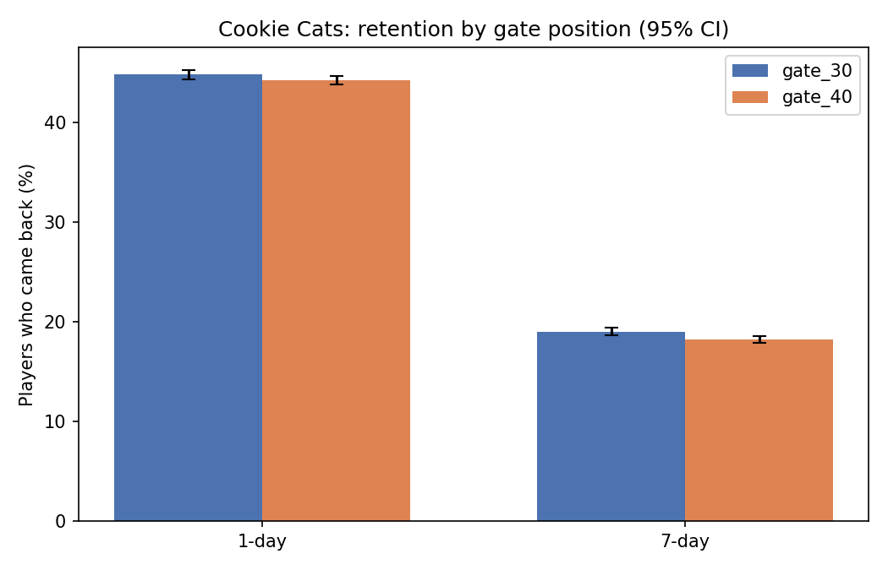

# Mobile Game A/B Test: Does Moving the First Gate Hurt Player Retention?

**Key insight:** moving the first gate from level 30 to level 40 lowered 7-day retention by 0.8 points (19.0% to 18.2%). The drop is unlikely to be chance (95% bootstrap CI -1.3 to -0.3 points). The 1-day difference (-0.6 points) was not clearly different from zero.

**At a glance:** 90,189 players · 2 groups (gate_30, gate_40) · Python (pandas, numpy, scipy, matplotlib) · bootstrap confidence intervals and two-proportion z-tests.

## Business question

In the Cookie Cats mobile game, a gate is a point where players must wait (or pay) before they can continue. If the first gate moves from level 30 to level 40, do more or fewer players come back after 1 day and after 7 days?

## Findings

| Metric | gate_30 | gate_40 | Difference (gate_40 minus gate_30) | 95% bootstrap CI | p-value |
|---|---|---|---|---|---|
| 1-day retention | 44.82% | 44.23% | -0.59 points | -1.24 to +0.05 | 0.0744 |
| 7-day retention | 19.02% | 18.20% | -0.82 points | -1.32 to -0.33 | 0.0016 |

- 7-day retention is about 4% lower in relative terms with gate_40 (0.82 / 19.02).
- 1-day retention: the data does not show a clear difference. The confidence interval includes zero.
- Game rounds (first 14 days): mean 52.5 (gate_30) vs 51.3 (gate_40); median 17 vs 16. The Mann-Whitney test gives p = 0.0502, which is borderline.

[](outputs/retention_chart.png)

## Statistical checks

**Is the split fair?** The groups have 44,700 and 45,489 players (49.6% and 50.4%). A 50/50 check gives p = 0.009. The imbalance is small in practice, but it is statistically unusual and may mean the random assignment was not perfect. The cause cannot be found from this data.

**Is the 7-day drop real?** The 95% bootstrap interval (-1.32 to -0.33 points) does not include zero, and the z-test gives p = 0.0016. Two outcomes were tested (1-day and 7-day), so a stricter threshold is 0.025 (0.05 split over two tests). The 7-day result passes it. The 1-day result does not.

**Why is the 1-day result unclear?** With about 44,700 players per group, the test could reliably detect (80% of the time) a difference of about 0.93 points for 1-day retention and 0.74 points for 7-day retention. The observed 1-day difference (0.59 points) is smaller than 0.93, so a small 1-day effect cannot be ruled out.

**Players who never played:** 3,994 players (4.4%) have 0 game rounds, and one player has 49,854 rounds. Retention is a yes/no outcome, so extreme players do not distort it much. They do distort the mean number of rounds, so the median is also shown.

## Recommendation

Keep the first gate at level 30, unless a separate analysis shows that gate_40 earns enough extra revenue to make up for 0.8 points lower 7-day retention. This dataset has no revenue or purchase data, so that trade-off cannot be tested here.

## Method

- Python (pandas): data checks (missing values, duplicate player IDs, group sizes, sample ratio check).
- Python (numpy, scipy): 95% Wilson intervals for each retention rate, a 2,000-resample bootstrap interval for each difference, two-proportion z-tests, a Mann-Whitney test for game rounds, and a simple sensitivity (minimum detectable difference) calculation.
- Python (matplotlib): retention chart.

## Data

Kaggle: [Mobile Games: A/B Testing](https://www.kaggle.com/datasets/yufengsui/mobile-games-ab-testing) (cookie_cats.csv, 90,189 rows: userid, version, sum_gamerounds, retention_1, retention_7).

## How to reproduce

```
pip install pandas numpy scipy matplotlib
# download cookie_cats.csv from Kaggle and save it as:
#   data_raw/cookie_cats.csv
python ab_test_analysis.py
```

The script writes `outputs/results.txt` and `outputs/retention_chart.png`.

## Repo layout

```
.
├── README.md
├── ab_test_analysis.py
├── outputs/
│   ├── results.txt
│   └── retention_chart.png
└── data_raw/        raw CSV (not committed, download from Kaggle)
```

## Limits

- One test on one game. Results may not apply to other games or other periods.
- Retention is measured as a single yes/no check at day 1 and day 7.
- The two groups differ slightly in size (sample ratio check p = 0.009), so the random assignment may not have been perfect.
- No revenue or purchase data, so the effect on income is unknown.
- This is an observed result from a test, but the data cannot show why players leave.

## Next step

Re-run the analysis without the 3,994 players who never played, to check that the 7-day result holds. Then compare the retention loss against revenue data, if it can be obtained.
